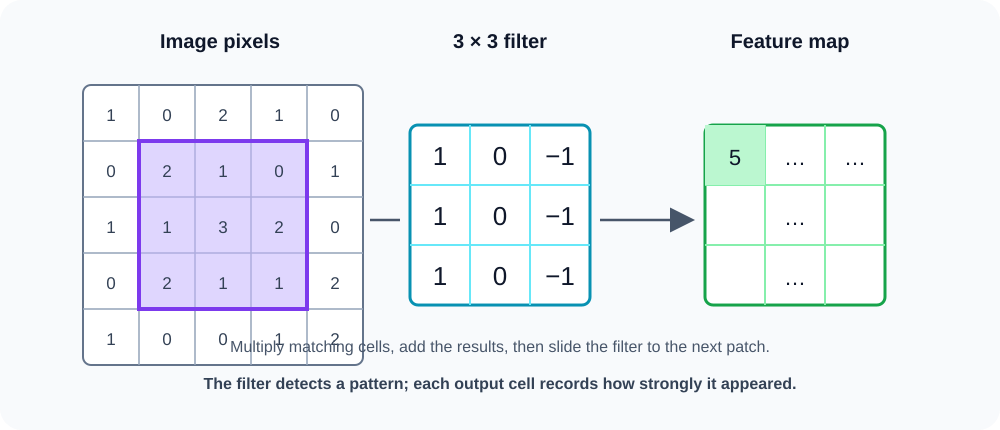

# Convolutional neural networks (CNNs)

## The big idea

A **convolutional neural network (CNN)** looks for small visual patterns—like edges, corners, or textures—and combines them into larger patterns. It is commonly used with images because nearby pixels often belong to the same shape.

## A filter scans an image

A **filter** (also called a kernel) is a small grid of learned numbers. The CNN places it over a patch of the image, multiplies matching cells, and adds the results. Then it slides the filter to the next patch. The collection of results is a **feature map**.

In the picture, the highlighted 3 × 3 patch is multiplied cell by cell by the filter. Adding those products gives one feature-map value. Sliding across the image fills in the rest of the map.

## Why this helps

- The same filter can spot a pattern anywhere in the image.
- Small filters use fewer learned numbers than connecting every pixel to every neuron.
- Early layers can find simple edges; later layers can combine them into parts and objects.

### Remember

> A convolution slides a small learned filter over an image. Each position produces a number describing how strongly the filter’s pattern appears there. The map of those numbers is a feature map.
