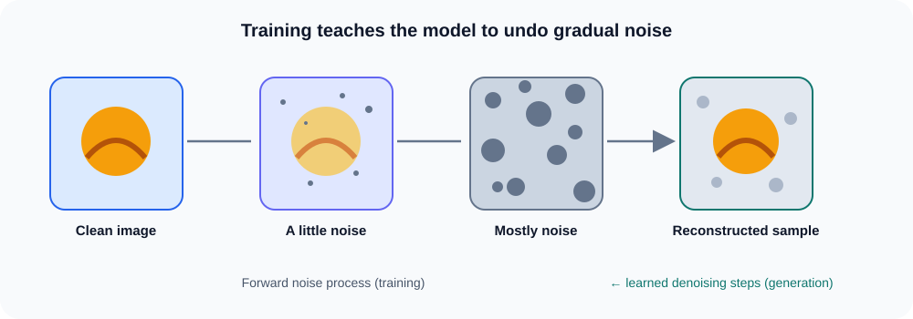

# Diffusion models

## The big idea

A **diffusion model** learns to create an example by starting with random noise and gradually cleaning it up. During training, it sees examples with different amounts of added noise and learns to predict what noise to remove.

## Two directions

The **forward process** gradually adds noise to a training image. The **reverse process** uses the trained model to remove noise a little at a time. Starting the reverse process from random noise produces a new sample.

The illustration uses a simple sun shape so the stages are easy to see. Real models work with much larger images and many small denoising steps.

### Remember

> Training teaches the model how noise changes real examples. Generation starts with noise and repeatedly removes predicted noise until a new, clear sample appears.
