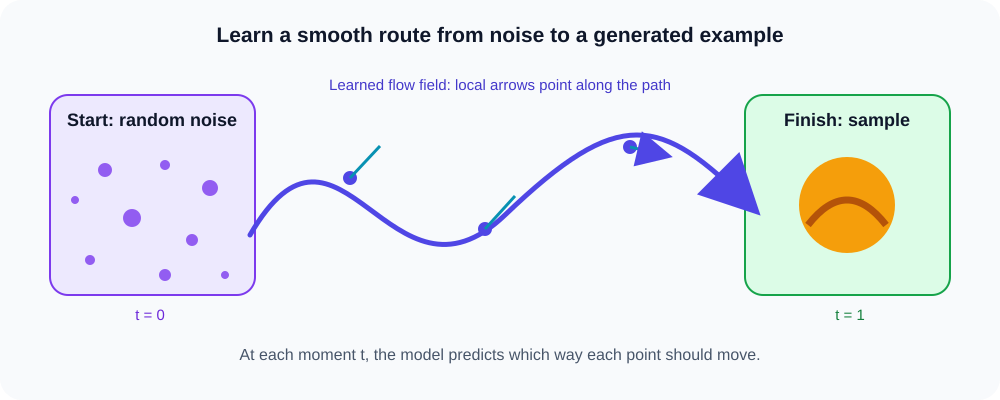

# Flow matching

## The big idea

**Flow matching** teaches a model how to move points smoothly from a simple starting distribution, often random noise, toward examples that look like the training data. Imagine guiding a cloud of scattered dots into a recognizable shape.

## Follow the path

At each point along the way, the model predicts a small direction to move. A sequence of these directions forms a **flow**. At time $t=0$ we start with noise; by $t=1$ we have moved toward a generated sample.

The purple curve is one example path. The small arrows indicate local directions. A computer follows many such small steps to turn an initial random point into a sample.

### How it compares with diffusion

Both methods can generate samples by following a learned sequence of changes. Diffusion is commonly explained as repeated denoising; flow matching learns a velocity or direction field that transports points along a path.

### Remember

> Flow matching learns where to move at each moment. Begin with noise, follow the predicted directions, and arrive at a generated example.
