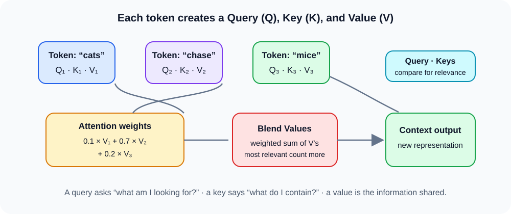

# Transformers and attention

## The big idea

A **transformer** processes a sequence—such as words in a sentence—by letting each item gather information from other items. The mechanism that chooses which items matter most is called **attention**.

## Queries, keys, and values

Each token is converted into three learned representations:

- **Query (Q):** what this token is looking for.
- **Key (K):** what this token can be matched on.
- **Value (V):** the information this token can share.

Attention compares a query with keys to make relevance scores. It turns those scores into weights, then uses the weights to blend the matching values into a new context-aware representation.

For “cats chase mice,” the word “chase” might pay more attention to “cats” and “mice” than to itself. The exact weights are learned from data and depend on the sentence.

### Remember

> A query asks, “What am I looking for?” Keys help choose relevant tokens. Values carry the information that gets combined. Attention lets each token build a representation informed by its context.
