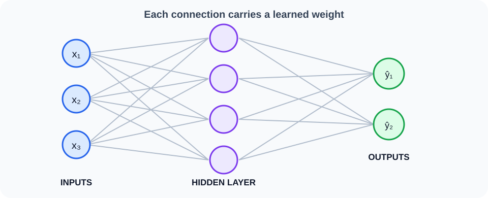
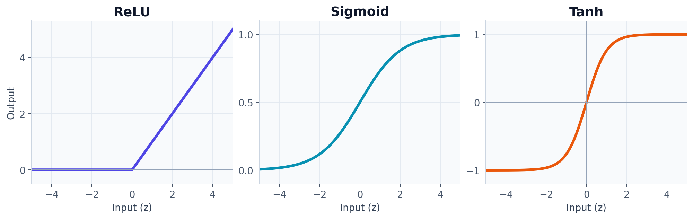

# Neurons, layers, and activation functions

## The big idea

A neural network is a series of small number-crunching steps. A **neuron** looks at its inputs, gives each one a level of influence, adds a small adjustment, and produces an output. Many neurons working together form a **layer**.

### A network at a glance

Each circle is a neuron. Lines show information passing from inputs, through a hidden layer, to the outputs.



## One neuron, step by step

Imagine estimating how likely a student is to enjoy a school trip from the price and the travel time.

1. Each input gets multiplied by a **weight**. A larger weight means that input matters more to this calculation.
2. The neuron adds a **bias**, a learned adjustment that shifts the result up or down.
3. An **activation function** turns the result into the neuron's output.

```text
price ──× weight ──┐
                   ├── add ── activation ── output
travel time × weight┘       + bias
```

In symbols, the calculation is $z = w_1x_1 + w_2x_2 + b$, then $a = \phi(z)$. Here `x` is an input, `w` is a weight, `b` is a bias, `z` is the total before activation, and `φ` (“phi”) names the activation function. These are just compact names for the steps in the diagram.

## Why use activations?

An activation can let the network model curved or more complicated patterns. Without activations, stacking layers is still just one big straight-line calculation. ReLU is a common activation: it changes negative values to zero and leaves positive ones alone.

| Activation | In everyday terms | Often used for |
|---|---|---|
| **ReLU**: $\max(0,z)$ | Keep positive values; replace negative ones with zero | Hidden layers |
| **Sigmoid**: $1/(1+e^{-z})$ | Squash a value into the range 0 to 1 | One yes/no probability |
| **Tanh** | Squash a value into the range −1 to 1 | Some hidden states |
| **Softmax** | Turn several scores into probabilities that add to 1 | Choosing one of several classes |

### What the activation graphs show

Each graph shows how one activation changes an input number. ReLU clips negative values at zero; sigmoid and tanh smoothly squash values into smaller ranges.



For example, softmax might turn scores for “cat,” “dog,” and “bird” into 0.7, 0.2, and 0.1.

## Example calculation

Suppose the inputs are $x=(2,-1)$, the weights are $w=(0.5,1)$, and the bias is $b=-0.25$:

$$z = (2\times0.5) + (-1\times1) - 0.25 = -0.25$$

ReLU turns this into 0. Another activation could give a different output from the same inputs. The network learns useful weights and biases during training.

## Layers and shapes

A layer applies the same kind of calculation to many inputs at once. If a batch has 32 examples, each with 10 features, and the layer has 4 neurons, the output has shape `(32, 4)`: 32 rows, 4 numbers per row.

```text
32 examples × 10 input features → layer with 4 neurons → 32 × 4 outputs
```

## Remember

> Weights set how strongly inputs count; bias shifts the calculation; activation adds useful behavior. A layer is many neurons doing this in parallel. Shapes tell you how many examples and values are flowing through the network.
