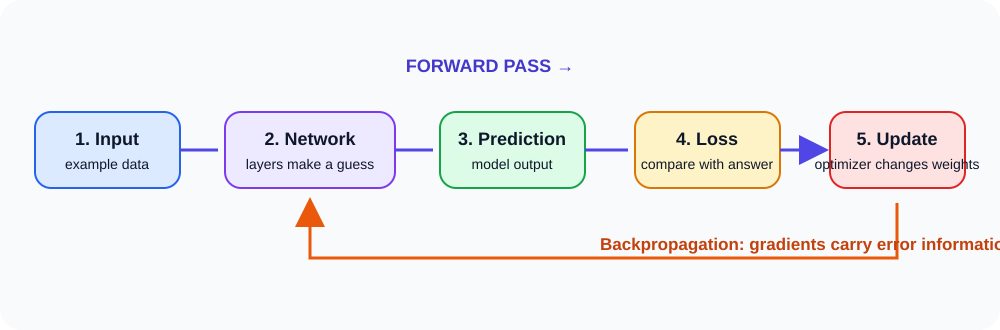

# MLPs, forward propagation, and backpropagation

## The big idea

A **multilayer perceptron (MLP)** is a neural network made from layers connected in order. It takes in numbers, transforms them through hidden layers, and produces an answer. Learning has two main directions: the **forward pass** makes a guess; **backpropagation** works backward from the mistake to find how the model should change.

## Follow one prediction

Imagine a model estimating a house price from its size and number of rooms.



```text
house details → hidden layer → predicted price
                    ↑                 ↓
              adjust weights ← compare with actual price
```

The model first sends information forward through its layers. It compares the predicted price with the actual price to calculate a **loss**. Backpropagation then sends information about that loss backward through the calculations. An **optimizer** uses the resulting gradients to adjust the weights and biases.

## What the names mean

- **Forward propagation:** calculate the model's output from its input.
- **Loss:** a number describing the size of a mistake.
- **Backpropagation:** work out how each learned number contributed to the loss.
- **Gradient:** a direction and amount showing how the loss would change if a learned number changed slightly.
- **Optimizer:** the rule that uses gradients to update learned numbers.

Backpropagation uses the chain rule—the rule for tracing how a change moves through a sequence of calculations. You do not need to calculate it by hand to understand the training loop.

## A tiny example

Suppose the guess is $\hat y = wx+b$, with input $x=2$, weight $w=1$, bias $b=0$, and correct answer $y=5$. The model predicts 2, so it is too low. For the simple loss $L=\frac12(\hat y-y)^2$, the gradients are $\frac{\partial L}{\partial w}=-6$ and $\frac{\partial L}{\partial b}=-3$. These numbers tell us which direction to move the weight and bias to reduce the loss. The symbols $\partial L/\partial w$ mean “how the loss changes when the weight changes.”

## The training loop

```text
input → predict → measure loss → find gradients → update weights
  ↑                                                   │
  └──────────────── next batch of examples ──────────┘
```

1. Give the model a batch of examples.
2. Make predictions (forward pass).
3. Compare predictions with the correct answers (loss).
4. Find gradients (backpropagation).
5. Update weights and biases (optimizer).

This repeats many times. One complete pass through all training examples is an **epoch**; a smaller group used for one update is a **batch** or **minibatch**.

## Remember

> Forward propagation makes the guess. The loss measures the mistake. Backpropagation finds how learned numbers affected it. The optimizer changes those numbers so the next guess may be better. Backpropagation and the optimizer are related steps, but they are not the same thing.
