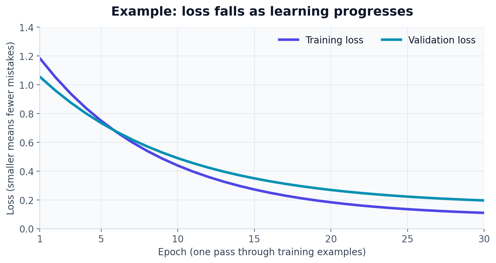

# Optimization and loss functions

## The big idea

A **loss function** gives a model a score for how wrong its predictions are. **Optimization** is the process of changing the model's weights and biases to lower that score. It is a little like learning by checking an answer, noticing the error, and adjusting your next attempt.

```text
make prediction → calculate loss → adjust model → try again
                      ↑                         │
                      └──── loss gets smaller ──┘
```

### A typical training curve

This example shows loss shrinking as the model sees more training data. Validation loss is measured on held-out examples to check whether learning transfers.



## Gradient descent: take a step downhill

The **gradient** points toward where the loss increases fastest. Gradient descent takes a step the other way, downhill. The **learning rate** controls the step size.

$$\text{new setting} = \text{old setting} - (\text{learning rate} \times \text{gradient})$$

If the learning rate is too large, updates may jump past a good setting. If it is too small, learning may be slow. Stochastic gradient descent (SGD) estimates the direction using a minibatch. Momentum and Adam use additional history to guide updates; Adam is common, but its learning rate still matters.

## Choose a loss that fits the task

| Task | Common loss | Plain meaning |
|---|---|---|
| Predict a number, such as a temperature | Mean squared error (MSE) | Average the squared gaps between guesses and answers |
| Predict yes or no, such as spam or not spam | Binary cross-entropy | Penalize the probability assigned to the wrong answer |
| Choose one of several classes | Cross-entropy | Penalize the probability assigned to the correct class when it is too low |

For MSE, $L = \frac{1}{N}\sum_i(\hat y_i-y_i)^2$. Here $N$ is the number of values, and $\hat y_i-y_i$ is the prediction's error. Squaring makes bigger errors count more.

For cross-entropy, the easiest case is one correct class: $L=-\log(p_{correct})$. If the model gives the right answer a high probability, the loss is small. If it gives the answer a very low probability, the loss is large.

## Example: finding a better setting

Suppose a simple loss is $J(w)=(w-3)^2$. We start at $w=1$, two steps from the best value $w=3$. A gradient step with learning rate 0.1 moves to 1.4, reducing the loss from 4 to 2.56. Repeating sensible steps can bring the setting closer to 3.

## Small Python example

This example uses plain Python to show an update for the simple loss above:

```python
w = 1.0
learning_rate = 0.1
gradient = 2 * (w - 3)  # slope of (w - 3) ** 2
w = w - learning_rate * gradient
print(w)  # 1.4
```

Real neural networks have many parameters, so a library calculates gradients and updates them for us.

## Remember

> The loss says what counts as an error. The optimizer says how to change the model. Gradient descent follows the gradient downhill, and the learning rate sets the step size. Match the loss to the kind of answer you want.
